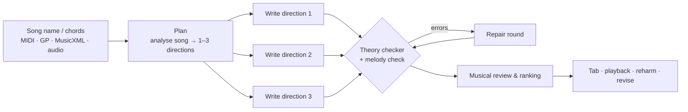

# 🎸 Fingerstyle AI

**Turn any song into a playable solo-guitar arrangement, not just a transcription.**

Give Fingerstyle AI a song (a name, a chord chart, or a real MIDI / Guitar Pro / MusicXML / audio file) and, if you like, a
direction: *"jazzy"*, *"folk fingerstyle"*, *"cinematic"*, *"make it sound good on solo guitar"*. It studies the
melody, harmony, groove and mood, proposes a few distinct arrangement ideas, writes them all, checks each one
against music theory and the original melody, ranks them, and lets you listen, compare, reharmonize and edit.

The tab is drawn by code, never by the model, so every fret number on screen has passed a checker.

---

## ✨ What it does

| | |
|---|---|
| 🧭 **Infers a direction** | Leave everything on *Auto* and it decides style, flair, level, reharmonization and how literally to keep the melody, and tells you why each choice suits *this* song. |
| 🎼 **Writes real solo guitar** | Melody on top, independent thumb bass, inner voices, idiomatic voicings. Hammer-ons, pull-offs, slides, natural & harp harmonics, taps, slaps, body knocks, triplets, alternate tunings and capo, used where they serve the music. |
| 🔀 **Several alternatives, ranked** | 1–3 genuinely different takes (e.g. *faithful hymn*, *chorale with moving voices*, *percussive groove*) written in parallel and ranked by a deterministic musical review. |
| ✅ **Honest about accuracy** | Imported melodies are verified note by note. A song named from memory is marked **Unverified**. Every score is labelled *Verified*, *Estimated* or *Unverified*. |
| 🎚️ **Steerable** | Optional controls: style, flair (clean → showstopper), level, reharmonization (none → bold), melody fidelity (exact / embellished / free), fretboard area. |
| 🔁 **Editable** | Click any chord for 5 reharmonizations, previewed in context. Ask for revisions in plain words ("bar 6 is too much of a stretch"). Retake a direction, undo anything. |
| 🎧 **Playable & readable** | Tab with rhythm stems or tab + staff, chord diagrams, guitar soundfonts (nylon, steel, jazz, clean), tempo trainer, metronome, count-in, looping, zoom, bars per line, full-screen practice view. |
| 📚 **Library** | Every arrangement you generate is saved automatically. Browse them as cards and filter by texture or by verified vs. from-memory melody. |
| 🏛️ **Classical catalogue** | Optional local copy of [ClassTab.org](https://www.classtab.org/)'s ~4,000 classical guitar tabs: browse by composer, read the tab, and turn any piece with MIDI into a verified arrangement. |

## 🧠 How it works



1. **Song IR, not tab text.** The model (Claude or Codex, via your own CLI login) returns structured JSON:
   sections, bars, chord symbols, voicings, and explicit tab beats with techniques (`lib/ir/schema.ts`).
2. **Deterministic checker** (`lib/theory/validate.ts`, using `tonal`): voicings must spell their chords, fret spans must
   be playable, beats must fill every bar, hammer-ons must go up the neck, harmonics must sit on real nodes. For
   imported tunes every melody note must be the top voice at the right time (exact) or within half a beat
   (embellished). Errors are sent back for up to two repair rounds.
3. **Musical review** (`lib/eval/review.ts`): melody kept, melody stands out, harmonic fit, voice leading, groove
   coherence, playability for the chosen level, techniques in proportion, reharmonization amount vs. what was asked.
4. **Rendering**: IR → alphaTex → [alphaTab](https://alphatab.net) for notation, tab, chord diagrams and playback.

## 🚀 Quick start

```bash
npm install
npm run dev        # http://localhost:3000
npm test           # theory checker, renderer, review & planner tests
```

Pick the model in the header. No API keys needed:

- **Claude**: uses your local `claude` CLI login.
- **Codex**: uses your local `codex` CLI login.
- **Claude API**: appears when `ANTHROPIC_API_KEY` is set in `.env.local`.

The **demo song** works without any model.

### Optional extras

```bash
# Much better guitar sounds (MIT-licensed MuseScore General, ~40 MB, git-ignored)
curl -L -o public/alphatab/MuseScore_General.sf3 \
  https://ftp.osuosl.org/pub/musescore/soundfont/MuseScore_General/MuseScore_General.sf3

# Audio import (MP3/WAV → MIDI with Spotify's basic-pitch). Needs uv.
cd worker && uv sync --python 3.11
```

Try an import with `examples/ode-to-joy.mid`.

### Classical catalogue (ClassTab)

```bash
npm run classtab:update   # downloads ClassTab's monthly zip (~14 MB) into data/classtab and indexes it
```

The tabs belong to ClassTab and its transcribers. They stay on your machine (`data/` is git-ignored) and are for
personal study. Open **Library → Classical** to browse them.

## ⏱️ What to expect

| Request | Typical time |
|---|---|
| One fingerstyle arrangement | 1.5–2.5 min |
| One showstopper arrangement (slaps, harmonics, runs) | ~4 min |
| Auto plan + 2–3 alternatives (parallel) | ~5–6 min |

Generation runs as a background job on the local server. If you reload or close the tab, the page picks the job back up when it opens again, and every result is saved to the library.

## 📏 Quality, measured

`npx tsx eval/run.mts` arranges public-domain tunes through the running app and scores melody accuracy (with a
chance baseline from scoring against *other* tunes), playability and flair. On five well-known tunes, both providers
kept 99–100% of melody notes exactly (chance ≈ 24%) with zero repairs, both from imported files and from memory.

## 🙃 Honest limits

- A song requested **by name** is written from the model's memory. Famous tunes come out right; lesser-known ones
  can be wrong, and Fingerstyle AI says so. Import a file for a verified melody.
- Ranking is **symbolic**: it reads the notes. It doesn't listen to the audio. Your ears get the final vote, so the UI makes auditioning
  every alternative one click.
- Fingerings are **estimated** from fret spans and hand shifts, not tested by a human hand.
- Audio import transcribes the whole mix; a clean recording of the melody works best.

## 🗺️ Roadmap

- Source separation (Demucs) before audio transcription for full-band recordings
- Swing feel, per-note left-hand fingerings
- Version history per arrangement, ratings to tune the ranking

## 🙏 Credits

[alphaTab](https://github.com/CoderLine/alphaTab) (MPL-2.0) for notation & playback ·
[tonal](https://github.com/tonaljs/tonal) for music theory ·
[basic-pitch](https://github.com/spotify/basic-pitch) (Apache-2.0) for audio → MIDI ·
Sonivox (Apache-2.0) and [MuseScore General](https://musescore.org/en/handbook/3/soundfonts-and-sfz-files) (MIT) soundfonts ·
built with Next.js, React and Tailwind.
